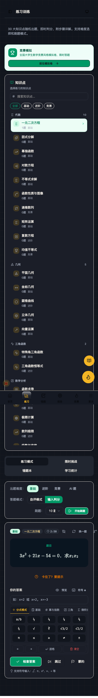

# P0 学习闭环（不花钱版）

## 一、先盘点：本来就有

翻代码发现数据层早就写好了，只是没有页面入口：

| 能力 | 位置 | 状态 |
|---|---|---|
| 错题本数据 + 艾宾浩斯复习阶段 | `src/hooks/use-learning.ts` | 已有 |
| 学习统计（连击/热力图/年报） | 同上 | 已有 |
| 收藏、练习设置 | 同上 | 已有 |
| 数据导出/导入备份 | `src/lib/data-backup.ts` | 已有 |
| 自动收录错题 | `src/pages/Practice/PracticePage.tsx` | 已有 |

缺的是：**独立页面 + 导航入口**。所以这轮不是重写，是接线。

## 二、这轮新增

### 1. 错题本页 `/wrong-book`

`src/pages/WrongBook/WrongBookPage.tsx`

- 三个分栏：今日复习 / 待重做 / 已掌握
- 按知识点筛选（显示每类错题数）
- 每道题展示：知识点、错因、复习阶段、下次复习时间、错误次数
- 「回忆起来了」推进一个复习阶段（间隔 1/3/7/14/30 天），
  「还是不会」重置回第 1 阶段，「直接标记掌握」或「删除」
- 折叠式答案与解析，避免直接看答案

### 2. 学习报告页 `/progress`

`src/pages/Progress/ProgressPage.tsx`

- 四个指标：连续天数、累计答题、总正确率、错题（待复习/已掌握）
- 到期提醒卡片 → 跳错题本
- **按知识点掌握度**：正确率进度条 + 题数，点击「练」直接进该知识点
- **建议优先练**：正确率最低且做过 ≥2 题的前 3 个知识点
- 复用热力图组件展示每日刷题量

### 3. 导航

- 侧边栏「学习」组新增：错题本、学习报告
- 移动端底栏改为：首页 / 练习 / 错题 / 报告 / 竞赛

## 三、验证

```
npm run check          # 八道关全绿
AUDIT_ROUTES=/wrong-book,/progress node scripts/audit-site.mjs
→ checks=8 routes=2 widths=375/1440，无溢出/无控制台报错/无裸 LaTeX
```

## 四、数学键盘（按题目推荐符号）

`src/components/SymbolPalette.tsx` 从"通用符号面板"升级成"按内容的数学键盘"：

- **9 个符号组**：基础 / 分式根式 / 幂与指数 / 三角 / 微积分 / 线代矩阵 / 概率统计 / 集合逻辑 / 希腊
- **按知识点自动推荐**：`MATH_SYMBOL_TOPIC_MAP` 把 20 多个知识点映射到对应组，
  进题时该组自动排到第一个并选中（积分题直接看到 ∫、∑；线代题看到矩阵括号、det）
- **光标跟随插入**：`a/b` 插成 `()/()` 且光标停在分子，`sqrt()` 光标停在括号里
- **控制键**：←、→ 移动光标，退格，清空
- 输出的是判分器认识的纯文本记号（`sqrt(2)/2`、`pi`、`^2`、`<=`），不是 LaTeX



接入点：`MathInputField` 新增 `topicKey` 属性，`PracticePage` 传入 `activeTopic`。

## 五、UI 快照回归

```bash
npm run ui:snap                      # 抓 5 个关键页面 × 2 个宽度
npm run ui:snap -- --routes=/practice,/progress
npm run ui:snap -- --update          # 把本次结果写成新基线
```

脚本 `scripts/ui-snapshots.mjs`：

- 自动拉起 dev server 与无头 Chrome（用完自动关掉）
- 每页做三项检查：**空白页**（正文 < 30 字符）、**横向溢出**、**控制台报错**
- 截图存 `artifacts/ui/<时间戳>/`，与 `baseline.json` 比对哈希，列出变动的页面
- 首页和练习页每次打开都会随机出题或跑倒计时，属于**动态页**，只做结构检查、不参与哈希比对
- 只保留最近 5 次产物

失败（空白 / 溢出 / 报错）时退出码非 0，可以直接进 CI 或 pre-push。

## 六、还没做（等有预算再说）

| 项 | 为什么现在不做 |
|---|---|
| 账号系统 | 需要服务端 + 短信/邮件服务，要花钱 |
| 云端同步 | 同上；当前用「数据备份导出/导入」替代 |
| 埋点上报 | 需要后端或第三方（友盟/神策），要花钱 |

数据现在全部在本机 localStorage，换设备请走「设置 → 数据备份」导出 JSON。
将来上云只需要把 `use-learning` 的读写层换成 API，页面不用动。
